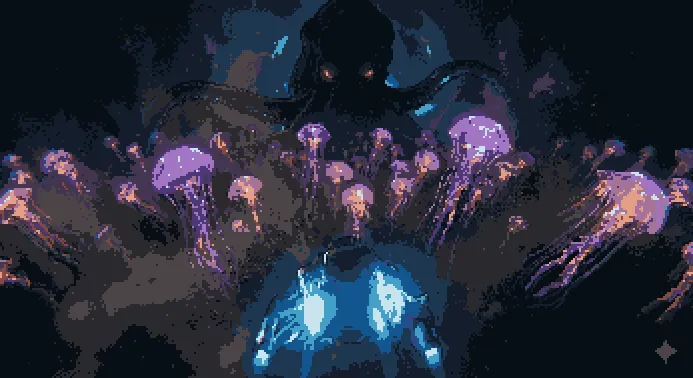
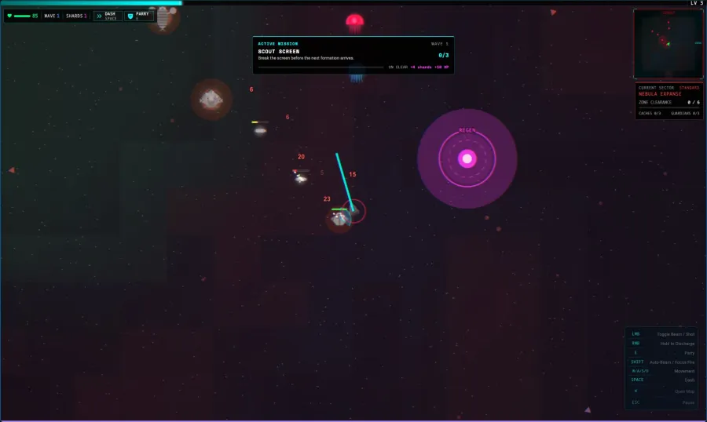
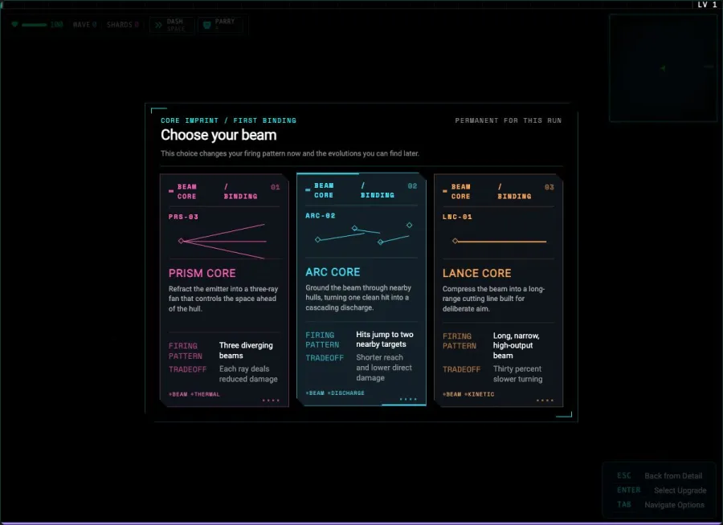

# Photon Swarm



A browser arena shooter that grew out of an entity system experiment. Fly through a conflict between four factions, choose a beam core, and build a run through upgrades, routes, and boss encounters.



## Run it locally

Requires Node.js 22 and npm.

```bash
npm ci
npm start
```

Open `http://localhost:4200`. The game opens in dark mode; switch to light in the in-game Settings menu. The game runs entirely in the browser. Progress and settings are stored in that browser's local storage, so saves from the original edconde.com version do not transfer to a new origin.

## How it works

- Game objects are integer entity IDs. Components hold data; systems handle movement, combat, rendering, territory, and progression.
- Component indexes and a lazily invalidated query cache avoid repeated full entity scans.
- Canvas rendering reuses cached enemy sprites, and the game loop runs outside Angular's change detection zone.
- Four NPC factions claim territory while the player moves between authored encounters and bosses.
- Mouse and keyboard controls have touch counterparts, along with remappable keys and colorblind palettes.

The source is under [`src/app/photon-swarm`](src/app/photon-swarm). Run `npm run typecheck`, `npm run test:ci`, and `npm run build` before changing game systems.



## Controls

Move with WASD or the arrow keys. Aim with the mouse, use the primary button to fire, and hold the secondary button to charge. Escape opens the pause menu. The in-game controls panel lists the full bindings and lets you change them.

## Scope

This is a standalone source release. The game canvas has limited screen reader access despite text announcements for some run events. Performance varies by device; the repository does not claim a fixed entity count or frame rate on every browser.

MIT licensed. See [LICENSE](LICENSE). Some inline icons are adapted from Phosphor Icons; see [their license](third_party/PHOSPHOR-LICENSE).
